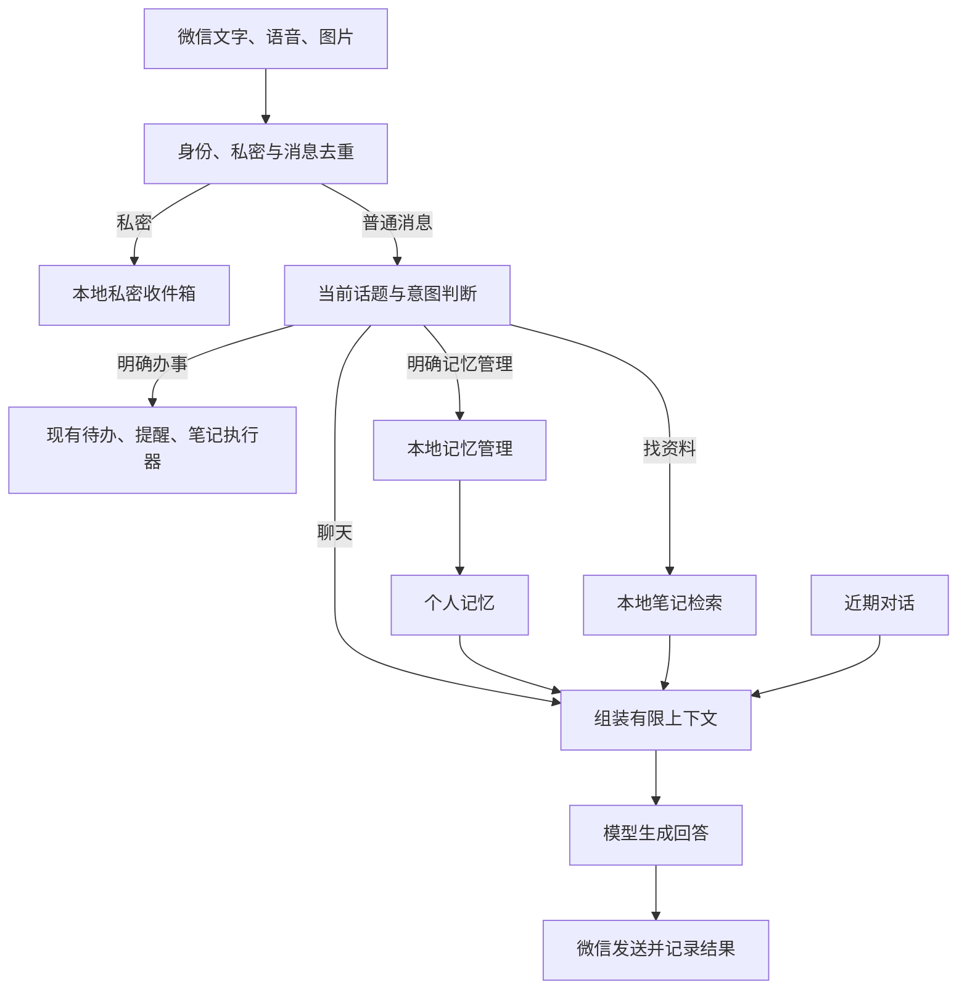

# 微信个人 AI 助手实施方案

日期：2026-10-21；实施状态更新：2026-10-26。版本：v5。交付 A 已启用到 owner、partner 两个秘书，见 [阶段 A 实施说明](chat-phase-a.md)。按用户要求，原交付 C 的长期记忆提前作为第二步，已完成并逐个启用，见 [长期记忆阶段说明](memory-phase.md)。原交付 B 的笔记检索作为第三步完成：893 项全量离线验收及独立审核通过，两个秘书均已逐个启用并核验在线，见 [笔记检索阶段说明](notes-search-phase.md)。第四步“安排查询与汇总”已完成：自然语言只读合并当前收件人的本地提醒和当前档案连接的滴答未完成待办；940 项全量离线测试及两个档案的真实滴答只读解析通过，已逐个启用并核验连接、健康看护和原数据一致，见 [安排查询阶段说明](schedule-query-phase.md)。第四步由主代理全程实施和自查，没有新建独立审核代理。用户随后自行向 owner 发送本周查询，收件、只读查询、微信回复及原数据核验通过；partner 尚未发送本轮测试，真实模型回答质量未在本轮验收。

## 1. 推荐路线与选择依据

采用“现有微信秘书 + 轻量对话与记忆 + 本地笔记检索”的结构。

明确选择：继续复用 Hermes 的微信接入、账号隔离、模型调用和现有秘书任务执行；由项目自身管理有限聊天记录、显式长期记忆及笔记索引。首版不启用 Hermes 通用代理会话和原生自动记忆，不同时引入 Mem0、Letta 或完整 Khoj 服务。

这一选择修正了 v2 的“优先接入原生会话和记忆”。原因是当前秘书在消息进入通用代理前已经处理并返回 skip；本地的 ctx.llm 同时提供 complete(messages) 和 complete_structured，可以直接补充聊天。原生记忆另有文件、会话快照和后台行为，再叠加项目的来源、保留期限及遗忘规则，会增加两个系统的一致性成本。首版自己管理少量受控状态更符合现有结构。

| 部分 | 首版决定 | 理由 |
|---|---|---|
| 微信接入、凭证、模型连接 | 复用 Hermes 的既有接口 | 已有两个独立档案和可用消息入口 |
| 滴答、笔记保存、提醒 | 继续使用原执行器，补充话题边界 | 保留现有校验、去重与失败处理 |
| 聊天历史、个人记忆 | 项目本地 SQLite，单一权威存储 | 同一事务管理内容、来源、状态和版本，便于更正与删除 |
| 笔记资料 | 原始 Markdown 留在 Obsidian，独立本地索引 | 关闭 Obsidian 后仍可检索；索引可重建 |
| 语义向量、自动记忆、跨应用代理 | 后续版本按实测需要加入 | 第一版先完成聊天、查资料和明确记忆的完整体验 |

这是针对当前代码的工程选择，不表示 Hermes 原生记忆或其他框架能力不足。

## 2. 完成后的整体结构

聊天生成没有通用工具执行权限。需要执行事项时，当前用户消息必须提供明确意图，再交给本地执行器。笔记、记忆和历史回答只是资料，不能授权操作。

## 3. 日常聊天：有限上下文与明确话题

第一版支持日常问答、讨论、解释、写作、连续追问；语音转写可作为聊天输入，图片继续经过已有安全处理。图片问答只依据可见内容，不能保证识别正确；原始图片和音频不作为长期聊天记忆保存。

建议初始默认值：

- 近期上下文最多 10 轮，同时限制总长度；达到上限时保留最近内容，明确过早话题可能不再记得。
- 普通聊天记录只保留本地最近 7 天；这是可调整默认值，不是无限历史。
- 首版不自动总结所有聊天，不后台提取人物画像，不提供独立的全历史搜索功能。
- “新话题”重置当前指代和操作焦点；“清空这段对话”删除当前保存的聊天；“临时聊天：……”仅处理当轮，不持久化。
- 当前消息、必要近期对话、少量相关记忆及笔记片段可能发送到现有云端模型。私密前缀仍只进入本地收件流程。
- 回答生成与微信送达分别记账。只有平台确认发送成功的回答，才作为已发送内容加入后续对话；送达不明不能当成用户已读，也不能自动反复发送。

新增“当前话题”状态：聊天、任务澄清、任务结果、笔记搜索结果、记忆管理。主题明显切换或状态超时后，单独的“搞定了”“就这个”“取消吧”不能操作旧任务。明确写出对象的命令仍可执行，含糊的对象只追问必要信息。

典型行为：

| 输入 | 应有结果 |
|---|---|
| “最近事情有点多，帮我理理思路” | 讨论和建议，不创建任务 |
| “把提交报告设为明天下午三点提醒” | 走原提醒规则 |
| 设置提醒后聊了几轮，再说“搞定了” | 不完成旧任务；必要时询问指的是哪件事 |
| “刚才第二个方案再详细讲讲” | 使用当前聊天焦点继续回答 |
| “把刚才第二项设为待办” | 先把具体事项解析出来；指代不唯一时展示事项请用户明确 |
| “忘记吃药了” | 作为陈述处理，不删除个人记忆 |

第一版不提供实时联网问答；涉及实时信息时说明尚未查询，不能伪装成最新结果。

## 4. 长期记忆：明确保存、可看、可改、可忘

首版只保存用户明确要求记住的偏好、背景、长期目标和项目事实。一次性提醒、临时情绪、引用资料、模型推测不能自动成为个人记忆。

提供四个主要入口：

- “记住：以后回答尽量简洁。”
- “你记住了我哪些事情？”
- “更正记忆：我的研究方向现在是……”
- “忘记关于旧研究方向的那条记忆。”

无歧义的明确命令直接处理，不再重复问是否允许；对象不唯一或新旧事实冲突时只追问必要内容。成功回复必须以数据库提交和回读为依据。

每条记忆有稳定 ID、事实内容、类型、来源引用、确认时间、有效期、版本号和状态。正文与这些元数据放在同一数据库事务中。每轮重新读取当前有效记忆，不依赖长期冻结的会话快照。容易变化的项目状态可设有效期；不会因一句旧描述永久认定当前状态。

上下文只带少量固定沟通偏好与本轮相关事实。较长研究资料存入笔记，不能无限堆到个人记忆里。

### “忘记”的精确定义

| 操作 | 实际范围 |
|---|---|
| 清空这段对话 | 删除当前保存的聊天和相关指代状态；保留个人记忆与原笔记 |
| 忘记指定记忆 | 删除该事实，清理相关缓存，并排除已追踪的来源及派生内容 |
| 排除某条笔记 | 助手停止检索该来源，原文件继续保留 |
| 删除原笔记 | 首版不提供；由用户在 Obsidian 中处理 |

遗忘范围明确限定为本系统已追踪的事实、来源和派生数据，不宣称自动识别所有同义改写或未知副本。无法精确排除来源片段时，先排除整个来源并说明影响。保留不含原事实正文的删除控制记录，防止重建索引时重新引入。

记忆更正或删除会使相关缓存及未发送回答失效，下一轮使用新状态。已经送达微信的旧消息无法由此撤回。历史备份按保留期限清理；恢复备份时必须重新应用最新删除控制记录，做不到时停止启用记忆检索，不承诺旧备份内容已被物理擦除。

## 5. 笔记检索：先找准，再根据来源回答

第一版直接读取各档案允许的 Markdown 目录，不依赖 Obsidian 桌面进程，不安装整套知识库平台。排除 PrivateInbox、隐藏配置目录、私密标记、越界路径及链接指向的目录。

现有“微信收件箱.md”包含多条追加笔记，必须按标题、来源标记和段落分块。每块保留文件路径、标题、记录日期、标签、来源 ID、原文位置和内容版本。

检索体验分两种：

1. “找一下上个月记的实验方案”：在本地检索，返回最多 5 条标题、日期、摘录和出处。
2. “这些方案有什么区别”：从本次有效结果中选少量原文片段交给模型，回答标明出处；新增建议与原文结论分开表达。

支持标题、正文关键词、标签和日期筛选；中文短词和中英混合术语需要专门处理。第一版不保证所有同义表达都能命中，模糊描述缺少关键词时可追问或提供筛选选项。

“上个月”等相对日期按 Asia/Shanghai 解析，优先使用笔记中可信的记录日期；没有记录日期时标明未知，不能把文件修改时间冒充写作时间。

索引采用增量更新：秘书保存笔记后通知更新，定期轻量扫描发现 Obsidian 内的修改、重命名或删除。返回片段前再次检查来源仍存在、内容版本匹配且未被排除。索引重建单独运行，不占用提醒状态库的锁。

已查阅 SQLite 官方全文索引说明：trigram 全文查询无法直接匹配不足三个 Unicode 字符的子串。实施时应选择应用侧中文分词或短词回退，并用固定中文查询集验证，不能把启用 FTS5 等同于中文检索已解决。[官方说明](https://www.sqlite.org/fts5.html#the_trigram_tokenizer)

## 6. 数据与运行边界

每个档案分别拥有三类存储：

| 存储 | 职责 |
|---|---|
| 现有 secretary.sqlite3 | 原任务操作、上下文和提醒队列 |
| 新增 assistant.sqlite3 | 有限聊天、个人记忆、当前话题、来源关系和删除控制 |
| 新增 notes-index.sqlite3 | 可从允许的原文重建的笔记索引 |

owner 与 partner 分别保存数据库、缓存和检索范围，当前档案由程序确定，不能由模型填写或更换。两套文件仍属于同一 Windows 账号权限范围，不视为操作系统用户之间的隔离。

第一版继续保持 Hermes 原生个人记忆、外部记忆 provider 和通用代理会话不参与新增处理，避免双重归档。只通过现有模型客户端调用生成接口；新增一个聊天用途配置，不另建一套凭证管理。

成本控制：纯命令和纯检索尽量零模型调用；普通聊天通常一次生成；只有需要理解复杂意图、改写查询或做笔记问答时才增加必要调用。固定系统提示、近期对话、记忆、检索片段分别设长度预算。记录实际耗时、调用次数和 Token 用量，不在未测量前承诺月费用或响应速度。

输入、检索片段和模型输出不得成为 shell 命令或自由路径。现有 Windows 自由文本传参规则继续适用。日志只记录脱敏状态、计数和错误类型。

## 7. 实施安排：三次可独立交付

可靠性检查作为独立基础工作并行推进：定位现有微信发送限流的具体条件，补充最近成功同步、提醒调度心跳、最近成功发送及失败状态。只有可证明未发送的错误才能安全退避重试；送达不明维持不自动重发。当前用户暂缓实发测试，此方案不触发微信发送。

| 交付 | 具体内容 | 验收与交付物 |
|---|---|---|
| A：能连续聊天 | 新增聊天生成、有限上下文、话题状态、临时聊天和清空；保留旧执行链 | 可单独开启聊天；连续追问正确；设置提醒后闲聊不会误完成任务；现有任务与私密回归通过 |
| B：能找笔记、依据资料回答 | 本地分块索引、中文关键词与筛选、结果编号、引用回答、删改同步 | 关闭 Obsidian 仍可搜索；结果可追溯；无命中时不编造；可独立关闭和重建索引 |
| C：能可靠管理个人记忆 | 显式记住、查看、更正、忘记；来源和删除控制；与聊天及检索集成 | 重启后仍可用；更正下一轮生效；已追踪的遗忘内容不重新召回；两个档案独立验证 |

A 的话题与上下文接口确定后，B、C 可并行开发，按各自验收结果逐项启用。三次交付全部完成才称为本轮“个人 AI 助手升级”完成；单项上线不冒充全部完成。

开发过程中使用合成数据和临时数据库。先对一个档案小范围启用，通过后再对另一档案启用；两个档案都要完成独立测试，不能只用其中一个的结果代替另一个。

本次不预估精确工期。开始实施时先确认本机 SQLite 中文检索能力、有限聊天 API 和数据迁移边界，再对 A/B/C 分别估算；不把方案阶段的估计当成交付承诺。

## 8. 验收标准与回滚

第一版至少建立约 50 个固定场景；质量目标是验收要求，不是当前已经达到的性能。

| 验收方向 | 必测条件 |
|---|---|
| 对话 | 连续追问、切换话题、清空、临时聊天、过期上下文 |
| 误操作 | “搞定了”“忘了吧”“忘记吃药了”“下午三点”等不能跨话题误操作 |
| 隔离 | 两档案交错发消息；个人记忆、搜索结果和待办对象不能串用 |
| 私密 | 文字与媒体私密前缀不进入云端、聊天存储、记忆或普通索引 |
| 检索 | 两字中文、中英术语、同名标题、同文件多笔记、标签、相对日期、无结果 |
| 排名 | 在预先标注的精确关键词测试集中，目标笔记应进入前 5 条；同义表达单独记录，不混入首版承诺 |
| 事实与引用 | 引文必须来自实际命中片段；资料冲突要展示来源；资料缺失不编造 |
| 更正与遗忘 | 下一轮、重启、索引重建后都不使用被撤销的已追踪内容 |
| 一致性 | 写入中断、数据库忙、索引落后、发送失败不能冒充成功 |
| 可恢复性 | 恢复备份时删除控制继续生效；失败不能重新执行已成功任务 |
| 运行体验 | 统计回答延迟、失败率、Token；索引工作不得持续阻塞到点提醒 |

功能分别开关：关闭聊天后明确任务仍可使用；关闭检索后原笔记保留；关闭记忆后停止注入与写入，并使旧缓存失效。聊天正文独立存储，后续记忆和检索数据也采用独立存储；原状态库只补充防误操作的焦点控制元数据。回滚不删除原笔记、不重放成功操作。

## 9. 首版之外

本轮暂不做自动人物画像、全历史永久保存、跨应用代理、自主操作电脑、主动发消息、全文云端同步、语义向量服务或复杂知识图谱。实时联网检索也作为后续独立能力。

首版完成后，根据固定问题集评估三项增强：中文同义检索、用户确认的自动记忆候选、项目资料摘要。只有实测收益明确时才引入新组件。

## 10. 网上参考如何落实到本方案

本节保留上一轮已核查的官方来源。它们支持设计参考；最终选型依据本项目的接入方式与边界。

| 参考 | 采纳点 | 首版采用程度 |
|---|---|---|
| [Hermes 记忆](https://hermes-agent.nousresearch.com/docs/user-guide/features/memory) | 区分关键个人事实和历史会话，记忆保存需核验 | 借鉴设计；复用底座模型与微信接口，不接入原生记忆生命周期 |
| [Khoj Obsidian](https://docs.khoj.dev/clients/obsidian/) | 搜索、摘录和围绕笔记连续问答 | 借鉴产品交互，自己实现受限本地索引 |
| [Mem0 OSS](https://docs.mem0.ai/open-source/overview) | 记忆接口可独立于聊天，组件可配置 | 后续语义记忆候选；不使用默认云端模型与嵌入配置 |
| [Letta MemFS](https://docs.letta.com/concepts/memfs) | 少量核心记忆和按需参考资料分层 | 采用分层思想，不为首版添加另一套运行时或 Git 记忆库 |
| [OpenClaw 记忆架构](https://docs.openclaw.ai/concepts/memory-architecture) | 来源追踪、阻止召回结果再次被抽取、遗忘范围管理 | 采用来源与验收要求，不迁移整套框架 |
| [Obsidian 官方 CLI](https://obsidian.md/help/cli) | 官方只读搜索、读取和双链能力 | 后续可选增强；基础搜索直接读允许的 Markdown |

本地决策依据：src/wechat_secretary/hermes_plugin.py 在前置分发中处理消息并跳过通用代理；src/wechat_secretary/classifier.py 已使用 ctx.llm；runtime/hermes-agent/agent/plugin_llm.py 提供 complete(messages)；现有 ledger 不保存完整普通入站正文。新增聊天与记忆因此放在独立的项目存储中。
